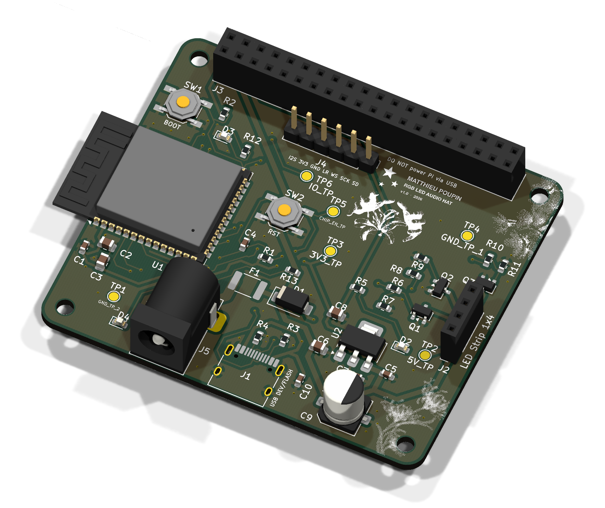
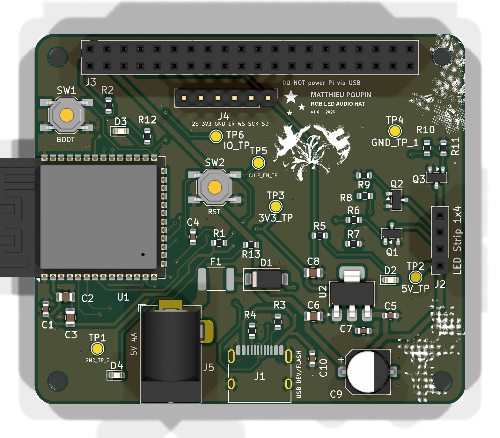
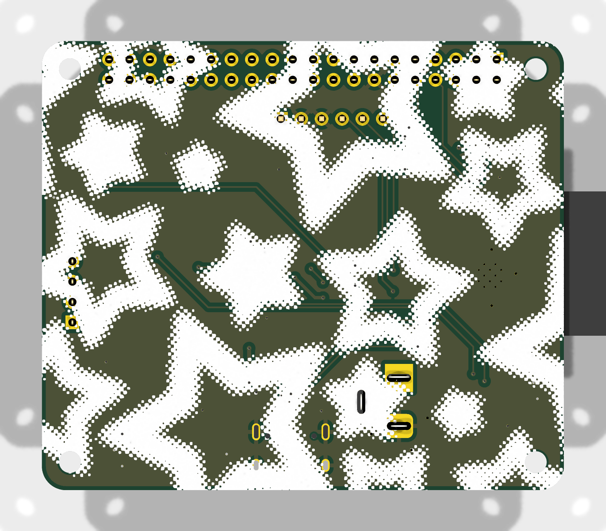

# RGB LED Audio HAT

Raspberry Pi HAT driving a 5 V analog RGB LED strip (common anode) from an ESP32-S3, with ambilight over UART and an optional I2S audio input.

Built to replace the cheap IR controller shipped with a generic 4-pin RGB strip.



> **Status:** schematic and layout complete, fabrication files ready. The board has not been ordered or built yet (bare PCBs cost about 2 €, the assembled version about 131 €), so nothing here has been validated on real hardware.

---

## Overview

```
Raspberry Pi 3B
  ├── Hyperion (ambilight)
  └── UART (GPIO14/15) ──► ESP32-S3
                              ├── 3× PWM ──► AO3400 MOSFETs ──► R/G/B (low-side)
                              └── I2S header (unpopulated)

RGB strip: 5 V, common anode. VCC to +5 V, each channel pulled to GND by a MOSFET.
Power: single external 5 V / 4 A supply, distributed by the HAT.
```

| Item | Value |
|------|-------|
| Board | 65 × 56 mm, Raspberry Pi HAT form factor |
| Layers | 2, 1.6 mm, 1 oz copper |
| MCU | ESP32-S3-WROOM-1-N16R8 (16 MB flash, 8 MB PSRAM) |
| Drivers | 3× AO3400 logic-level N-MOSFET, low-side |
| Firmware | Stock WLED + Hyperion protocol (no custom usermod) |

## Pinout

| Signal | GPIO | Notes |
|--------|------|-------|
| PWM_R / PWM_G / PWM_B | IO4 / IO5 / IO6 | Grouped, short routes to MOSFET gates |
| I2S_WS / SCK / SD | IO9 / IO10 / IO11 | Header present, not populated |
| UART TX → Pi | IO39 | UART1, **not** TXD0 |
| UART RX ← Pi | IO40 | UART1, **not** RXD0 |
| Status LED | IO41 | |
| USB D− / D+ | IO19 / IO20 | Hardwired to the native USB PHY |
| BOOT | IO0 | Button + 10 k pull-up |

## Test points

Six exposed 1.5 mm pads, silkscreen-labelled, reachable with the HAT seated on a Pi.

| Pad | Net | What it tells you |
|-----|-----|-------------------|
| TP1 | GND | Reference, board bottom-left |
| TP2 | +5 V | Input rail past the fuse: validates jack, F1, SS14 |
| TP3 | +3V3 | LDO output. If this is dead, nothing else can work |
| TP4 | GND | Second reference, board top-right |
| TP5 | CHIP_EN | Validates the 10 k/1 µF reset network. Held low = silent board |
| TP6 | IO0 | Boot mode. Distinguishes download mode from a board that does not start |

Two grounds sit diagonally opposite so a probe is never far from a reference.

The three PWM channels have no dedicated pads because they are not needed: the gates can be probed on the Rg resistor pads (R6/R8/R10, 0603) and the drains on the J2 strip header (1×4, 2.54 mm). Measuring both on one channel separates a firmware fault from a MOSFET fault.

## Bring-up procedure

Untested: this is the plan for the day a board exists.

**0. Before applying power.** Continuity check: no short between +5 V and GND, none between +3V3 and GND. If either beeps, stop.

**1. Power only.** Barrel jack in, nothing else. TP2 → 5 V ±5 %, TP3 → 3.3 V ±5 %, power LED lit, a few tens of mA idle.
*+5 V present but +3V3 absent → the LDO. Both absent → jack, fuse, or a short.*

**2. Module alive.** TP5 → 3.3 V (EN not held low). TP6 → 3.3 V at rest (pull-up). Current climbs to ~50-100 mA as the radio initialises.

**3. Flashing.** USB-C connected, board should enumerate as a serial port. Flash a bare blink on IO41 before WLED: validates the whole chain without depending on complex firmware.

**4. PWM, strip disconnected.** Firmware sweeping R, G, B. Scope the Rg pads: signal should vary. Then the J2 pins: drains follow inverted (low-side, gate high pulls drain to GND).
*Gate moving, drain static → MOSFET or solder. Gate static → firmware or GPIO.*

**5. Strip.** Short segment first.

**6. Pi UART.** Scope IO39/IO40 while Hyperion transmits.

Avoided throughout: GPIO26-37 (flash + octal PSRAM), strapping pins (0/3/45/46), and UART0 (43/44, boot log).

## Design notes

**Soldered module, not a dev board.** The goal of this board was to learn ESP32 routing: RF keep-out, native USB-C, regulator, boot/reset. A socketed DevKit would have skipped exactly the parts worth learning. JLC assembly removes the reflow risk on the module's thermal pad, leaving the layout as the only variable.

**Audio processing lives on the Pi.** Originally planned as a WLED FFT usermod in C++; moved to Python on the Pi instead. Sampling the digital source is more accurate than recording it through a microphone, and since the Pi already runs for the ambilight, an onboard mic would be redundant. The I2S header stays as a fallback (accepts an INMP441 or an S/PDIF receiver).

**Single 5 V supply.** The HAT feeds the Pi through header pins 2/4. Powering the strip from the Pi's own supply doesn't work: the official 2.5 A brick is already marginal, and the GPIO header isn't sized for another 1 A. USB-C PD was ruled out too: 3 A ceiling with no headroom against a ~2.55 A budget.

**Warning:** never plug in the Pi's own USB power while the barrel jack is connected, as this puts two sources on the same rail.

**J3 placement comes from a physical measurement of a Pi 3B**, not from a spec sheet. If a board ever gets built and doesn't seat correctly, check this first.

## Renders

| Top | Bottom |
|-----|--------|
|  |  |

Schematic: [PDF](hardware-schematic.pdf) or [PNG](images/schematic.png).

## Repository layout

| Path | Contents |
|------|----------|
| `rgb-led-audio.kicad_sch` | Schematic |
| `rgb-led-audio.kicad_pcb` | Layout |
| `rgb-led-audio.kicad_pro` | Project settings + netclasses |

Netclasses: `Power_In` 1.5 mm (jack → fuse, 2.5 A), `Power_5V` 0.8 mm, `Power_3V3` 0.4 mm, `LED` 0.5 mm, `Default` 0.2 mm. Sized for 1 oz copper, ΔT 10 °C.

## DRC status

Routing complete, 70 vias, single GND island with 43 stitching vias, no unrouted nets.

Accepted warnings:

| Warning | Rationale |
|---------|-----------|
| **No fiducials** (42 SMD components) | JLC assembles boards of this class without them. Adding three would cost nothing and is worth doing on a revision. |
| **Components near the board edge** (C1 0.97 mm, SW1 0.6 mm, J3 0.53 mm) | All above JLC's 0.5 mm recommendation. J3 is positioned to match the Pi header (see Design notes), so alignment takes priority over clearance. |
| **No ESD/TVS on VBUS** | The USB-C port is development-only and stays on a desk. Worth adding on a revision that leaves the bench. |

VBUS carries a 100 nF decoupling cap (C10) next to J1. A bulk cap would be redundant against the 220 µF already on the 5 V rail.

EMC risk score is 34/100. Twelve nets are flagged for missing stitching vias at layer transitions (RP-001). That rule becomes critical above ~100 MHz; the fastest signal here is USB 2.0 Full Speed at 12 Mbps. The only true HF source is the 2.4 GHz radio, which is internal to the module and behind a respected keep-out.

## Manufacturing

Targeted at JLCPCB, 2-layer, Standard assembly (the WROOM-1 is not available on the Economic line).

KiCad's BOM and CPL exports are **not** directly usable:

- BOM comes out semicolon-separated with no LCSC column → needs exactly `Comment, Designator, Footprint, LCSC Part #`
- CPL uses `Ref/Val/PosX/PosY/Rot/Side` and negative Y → needs `Designator, Mid X, Mid Y, Layer, Rotation` with Y flipped
- **Rotation +180° required** on SOT-23 (Q1-Q3), SOT-223 (U2) and SMA (D1). Skipping this mounts the MOSFETs and regulator backwards, and neither DRC nor ERC will catch it.
- Uncheck *Use drill/place file origin* when exporting the CPL
- Value casing matters: `1k` and `1K` produce two separate BOM lines in JLC's matcher
- J2/J3/J4/J5 are through-hole and excluded from the CPL on purpose (JLC will warn, that's expected)

Silkscreen artwork must stay above **0.15 mm** feature size or JLC silently drops it. Halftone-style images generally don't survive; solid shapes do.

## Bill of materials

| Ref | Part | LCSC |
|-----|------|------|
| U1 | ESP32-S3-WROOM-1-N16R8 | C2913202 |
| U2 | SGM2212-3.3 (LDO, tab = VOUT) | C3294699 |
| Q1-Q3 | AO3400 (SOT-23, G/S/D) | C181090 |
| D1 | SS14 Schottky | C2480 |
| F1 | PPTC 3 A | C883162 |
| J1 | USB-C 16P | C165948 |
| J5 | Barrel jack 5.5×2.1, 3 A | C84007 |
| SW1/SW2 | Tactile 6×6 mm | C55213946 |

Through-hole connectors (J2 1×4, J3 2×20 socket, J4 1×6, J5) are meant to be hand-soldered. TP1-TP6 are bare copper pads: no part, no BOM line, no cost.

Every symbol carries its LCSC code as a schematic property, so the BOM regenerates from KiCad without a manual mapping step.

**Warning:** the files under `fab/` predate the test points and C10. Re-export the Gerbers, BOM and CPL before ordering.

Sourcing notes: on PPTC fuses the number in the part code is in **centiamps** (BSMD1812-**300** = 3 A). Most LCSC barrel jacks are rated 500 mA, which is insufficient here.

## Cost

| Item | Price |
|------|-------|
| 5 bare PCBs | 2 € |
| 2 assembled + 3 bare | ~131 € |

Fabrication is negligible; the BOM is the entire cost. ~28 $ is the two ESP32 modules and ~21 $ is JLC's feeder fee for seven Extended Parts.

## Not done

- Never fabricated or tested
- No firmware written (stock WLED assumed, unverified)
- Pi-side FFT is a plan, not code
- Ambilight needs an HDMI splitter with HDCP strip + USB capture dongle, unless the Pi itself plays the content

## License

MIT
